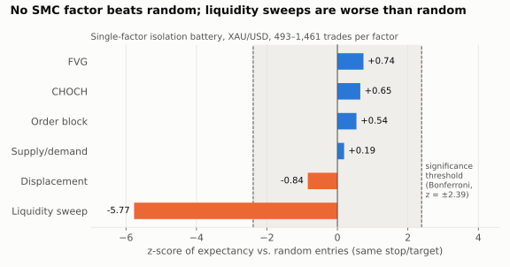
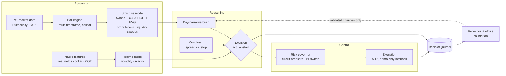

# XAU Market Intelligence

**A self-observing decision model for gold (XAU/USD). It reads market structure, classifies regime,
estimates confidence, decides when to act and when to abstain, journals every decision, and learns only
from evidence that survives statistical validation.**

[](https://github.com/Madhubala1985/xau-market-intelligence/actions/workflows/tests.yml)


> **Headline finding: a rigorous negative result.** I gave the model every pattern that discretionary
> "Smart Money Concepts" traders rely on and tested each one, alone and combined, against a random-entry
> control with out-of-sample replication. None of them carried information. The model's correct decision
> was to abstain, and it did. The only effect that survived is a macro regime signal, which now runs as a
> risk dial. Full write-up: [`docs/40_CONCLUSION.md`](docs/40_CONCLUSION.md).



---

## What "intelligence" means here

The project charter ([`docs/00_PROJECT_CHARTER.md`](docs/00_PROJECT_CHARTER.md)) defines it in testable terms.
It does **not** mean predicting every candle. It means:

- understanding market context (structure, liquidity, session, macro regime)
- measuring confidence and uncertainty, and treating *no action* as a valid decision
- detecting its own mistakes through a decision journal and reflection loop
- changing itself only after offline validation, never live during market hours

## Architecture



| Layer | Components (`src/`, `research/`) |
|---|---|
| **Perception** | Dukascopy M1 fetcher (XAU, XAG, EURUSD, DXY; 0.9997 correlation vs. GLD), causal multi-timeframe bars, swing/BOS/CHOCH detection, fair-value gaps, order blocks, supply/demand, liquidity sweeps, session and kill-zone levels |
| **Context models** | Volatility regime classifier, macro walk-forward Ridge model (real yields, breakevens, dollar, CFTC positioning), ML walk-forward experiments |
| **Decision** | Three-brain engine: day-narrative brain + regime dial (can only tighten) + cost brain, combined on a single decision path |
| **Self-observation** | Decision journal (trades *and* no-trade decisions), reflection engine, calibration replay, edge audit |
| **Control** | Risk governor with per-trade / daily / weekly circuit breakers, mandatory stop, no martingale, MT5 gateway that refuses real-money orders |
| **Research lab** | Causal backtest harness, setup library, edge scanner, factor-isolation battery, pre-registered ship gates |

## Validation methodology

The model is only allowed to learn from a signal that passes every stage, in order
([`docs/41_METHODOLOGY.md`](docs/41_METHODOLOGY.md)). Each protocol was committed **before** its run.

1. **Strictly causal replay**: bars are finalized before any decision, so there is no look-ahead
2. **Frozen classification gate**: ≥100 trades, expectancy ≥ +0.10R, profit factor ≥ 1.30, keeps ≥50% of its edge under a spread/slippage stress grid
3. **Walk-forward / multi-regime k-fold**: positive across periods, not just recently
4. **Random-entry control** with identical stop/target geometry, Bonferroni-corrected (z ≥ 2.39)
5. **Untouched holdout**: 2026 data stayed sealed until the final test

## Results: the evidence chain

| Hypothesis the model was given | Verdict |
|---|---|
| Day-narrative brain, replay-tuned to +10.7R over 12 days | Overfit; failed validation |
| Expected-value setup ranker ("Gold-Alpha") | −15.93R over 10 days, 17% hit rate → **not shipped** |
| 5 mechanical SMC setups on real data | **No edge / insufficient** on all 5 |
| Donchian H1 breakout + regime filters | Real drift but **non-stationary** (lost 2011–17, all profit 2023–26) |
| Macro multi-factor model | Out-of-sample IC +0.079, but **Sharpe 0.64 < buy-and-hold 0.83** |
| Single-factor isolation (6 SMC factors) | **0 of 6 beat random**; liquidity sweep significantly *worse* (z = −5.77) |
| Three-brain rebuild, pre-registered multi-year gate | Net **−73.7R over 566 trades**, positive in only 2 of 14 windows; even at zero cost **−1.56R over 596 trades** (a coin flip) → **model stays flat** |

**Conclusion.** At daily and hourly horizons with free public data, gold is efficiently priced with respect
to the patterns retail SMC trading depends on. The real effects (volatility regime, real-yield/dollar regime)
work as a **risk overlay** that cuts drawdown, not as a source of return.

**Shipped:** `research/regime.py` + `scripts/gold_regime.py`, an advisory macro regime risk dial.

## What this project demonstrates

- **ML/research rigor:** pre-registration, multiple-comparison correction, walk-forward and k-fold validation, random controls, sealed holdouts, and avoiding leakage in time series
- **Decision-system design:** abstention as a first-class output, confidence gating, a journal + reflection loop, and offline-only adaptation
- **Production Python:** typed Pydantic domain models, 906 tests, layered architecture, fail-closed safety interlocks
- **Scientific honesty:** knowing when the data says *no*, and reporting it

## Repository layout

```
src/        perception (data, structure, liquidity, orderflow), regime, strategy, risk,
            execution, broker (MT5), journal, reflection, backtest
research/   causal research harness, macro data, metrics, regime dial
scripts/    data fetchers, edge scans, factor isolation, replay gates, ML walk-forward
tests/      906 unit and integration tests
reports/    research reports and gate protocols
docs/       charter, policies, designs, decision log, research findings, conclusion
```

Key documents: [Charter](docs/00_PROJECT_CHARTER.md) · [Architecture](docs/02_ARCHITECTURE.md) ·
[Methodology](docs/41_METHODOLOGY.md) · [Research findings](docs/30_RESEARCH_FINDINGS.md) ·
[Decision log](docs/11_DECISION_LOG.md) · [Conclusion](docs/40_CONCLUSION.md)

## Quick start

```bash
python -m venv .venv && source .venv/bin/activate
pip install -r requirements.txt
pytest                                  # 906 tests, ~3 s
python scripts/fetch_dukascopy.py       # fetch data (not included, ~2 GB)
python scripts/intel_replay.py --gate   # run the multi-year ship gate
python scripts/gold_regime.py           # macro regime risk dial
```

Raw market data and broker credentials are not included.

## Related projects

| Project | Domain | Focus |
|---|---|---|
| **XAU Market Intelligence** (this repo) | Gold, MT5 | Statistical validation of what a model is allowed to learn |
| [NSE Market Intelligence v1](https://github.com/Madhubala1985/nse-market-intelligence-v1) | Indian index options | Foundation: event-driven perception and context pipeline |
| [NSE Market Intelligence v2](https://github.com/Madhubala1985/nse-market-intelligence-v2) | Indian index options | Live autonomous model on cloud infrastructure, LLM analyst benchmark |

---
*Built with AI pair-programming (Claude Code) under a written engineering workflow
([`docs/09_CLAUDE_WORKFLOW.md`](docs/09_CLAUDE_WORKFLOW.md)). Research and education only; not financial
advice. No real-money orders were placed.*
